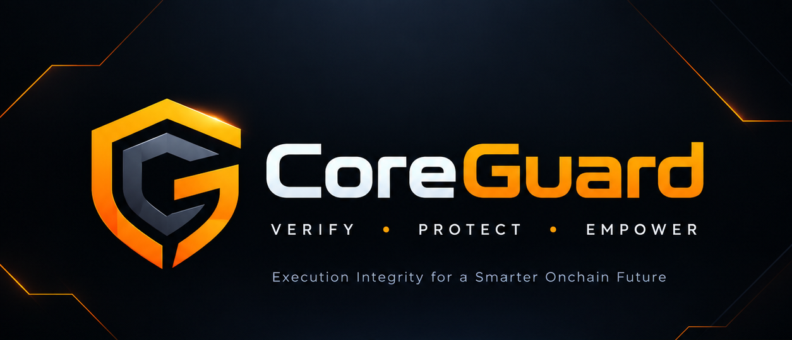

<picture>
  <source media="(prefers-color-scheme: dark)" srcset="https://raw.githubusercontent.com/coreguard-global/.github/main/brand/coreguard-banner-dark.png">
  <source media="(prefers-color-scheme: light)" srcset="https://raw.githubusercontent.com/coreguard-global/.github/main/brand/coreguard-logo-light.png">
  
</picture>

### CoreGuard Global

**Independent Execution Trust Infrastructure** — security and verification
infrastructure for AI agents, wallets, payments and decentralized applications.

<!-- COREGUARD:MCPRUSH:BEGIN -->
## CoreGuard Agent Commerce — Now listed on MCPRush

**Discover the open-source consent and execution-verification tools.**
CoreGuard Agent Commerce appears in the [MCPRush directory](https://mcprush.com/eslam-x/coreguard-agent-commerce-mcp).
This is a publicly indexed marketplace listing, checked on 21 November 2026; it is **not** a partnership, endorsement, funding award or independent security audit.
The observed listing is unclaimed and free, runs locally from its publisher's package, and is not hosted or billed by the marketplace.

[**Explore the package**](https://www.npmjs.com/package/@coreguard/agent-commerce) · [**Documentation**](https://coreguard-global.github.io/CoreGuard/DOCS.html) · [**Announcement & film**](https://coreguard-trust-and-defense.lovable.app/developments#mcprush) · [**Discuss a pilot**](https://coreguard-trust-and-defense.lovable.app/partners)

**VERIFY • PROTECT • EMPOWER.** Directory discovery is not adoption evidence. `VERIFIED ≠ SAFE`.
<!-- COREGUARD:MCPRUSH:END -->

---

## Two names, two jobs

| | |
|---|---|
| **CoreGuard Global** | The organisation — who signs, who hires, who is accountable. |
| **CoreGuard** | The product and protocol — the software, the receipts, the verifier, the network integrations. |

One product is sold: **CoreGuard Agent Execution Security**, an execution
verification and authorization layer that runs *beside* the wallet, agent
runtime, DEX or payment rail. It does not replace any of them.

## What we build

**CoreGuard makes the gap between "what was authorized" and "what actually
executed" measurable, refusable, and independently checkable.**

| Component | Question it answers | What ships |
|---|---|---|
| **Authorization Firewall** | Is this the thing that was approved, byte for byte? | Signed authorization bound to the exact transaction bytes |
| **Execution Verification** | Did what ran match what was signed? | `PASS`, or `BLOCK` with a named reason — never a score |
| **Verifiable Consent Receipts** | Can an outsider check it later? | Artifact + offline verifier: no secret, no network, no trust in us |

`UNKNOWN` is never success. The operation halts or holds until evidence closes
it — in the product and in how we report on ourselves.

## Markets

| Market | The problem | CoreGuard supplies |
|---|---|---|
| **AI Agents** | The agent executes an action that was not intended | Authorization & Execution Gate |
| **Wallets** | Approval and execution diverge | Transaction Verification |
| **DeFi / DEX** | Execution risk on swaps and conditions | DEX Execution Verification |
| **Escrow** | Disputes over whether an obligation was executed | Verifiable Receipts |
| **Agentic Commerce** | Agent purchases without consent or payment evidence | Consent & Payment Evidence |
| **FinTech** | Proving process integrity to an auditor | Execution Audit Trail |

**Beachhead:** AI agent payments and agentic commerce — the only segment where
all three components already have code behind them and the buyer's pain is
concrete. Wallets and DEXs are the second wave; enterprise policy packs third.

> A previous version of this profile described the company as a layer "for Bitcoin
> DeFi" while the repository said "for Stellar". Both were wrong as *identity*:
> networks are integrations, not the company. Canonical statement:
> [docs/POSITIONING.md](https://github.com/coreguard-global/CoreGuard/blob/main/docs/POSITIONING.md).

## Where the evidence actually exists

| Surface | Status (measured, re-derivable) |
|---|---|
| Engine + offline verifier (JS · Rust · WASM · C/Python) | BUILT · TEST_EXECUTED |
| Suite on the committed tree | **1955/1955 tests**, CI-measured every push |
| Boundary audit | **1469 files · 0 violations** |
| Core DAO contracts | **43/43** Foundry proofs, CI-measured; evidence registry LIVE on mainnet |
| Stellar mainnet | Soroban anchor `CCKA2GYV…QMMXPSP` (tx `69044807…`, ledger 65,337,373); first gated funded swap tx `ac2a7990…`, ledger 65,338,112 |
| Independent reproduction | AER-1 / Zambo team reproduced the open pilot kit byte-for-byte on three machines — [ACP #328](https://github.com/agentic-commerce-protocol/agentic-commerce-protocol/discussions/328) |
| Authorized lane on mainnet · wallet integration | **NOT DEPLOYED · NOT BUILT** |
| Customers · signed pilots · revenue · third-party audit | **ZERO · ZERO · ZERO · NOT PERFORMED** |

`VERIFIED ≠ SAFE`. A verification result describes the checks performed on the
evidence presented; it is not an audit, an endorsement, or a promise that an
outcome is safe.

## Funding status

**$150,000 requested — not awarded** (SCF #46 Build Award), milestone-gated over
four months: $40K for SDK v1, $55K for the authorized Soroban lane, $55K for two
external pilots plus a closed independent review. Each tranche is released
against an artifact a reviewer can inspect, not against elapsed time.

- Full pack: [COREGUARD-INVESTMENT-READINESS.md](https://github.com/coreguard-global/CoreGuard/blob/main/COREGUARD-INVESTMENT-READINESS.md)
- Application: [SCF-BUILD-APPLICATION-V3.md](https://github.com/coreguard-global/CoreGuard/blob/main/docs/SCF-BUILD-APPLICATION-V3.md)
- Business model: [docs/BUSINESS-MODEL.md](https://github.com/coreguard-global/CoreGuard/blob/main/docs/BUSINESS-MODEL.md)

## The organisation, on the record

| | |
|---|---|
| **Team** | Founder: EslaM HeshAM (MR-X) — protocol & security. Three contractor roles named in the funded plan; no advisor or reviewer is described as engaged until a document exists. [docs/TEAM.md](https://github.com/coreguard-global/CoreGuard/blob/main/docs/TEAM.md) |
| **Security reviews** | **No independent review performed.** Automated assurance, adversarial corpus and contract invariants run on every push; the review is budgeted, not bought. [docs/SECURITY-REVIEWS.md](https://github.com/coreguard-global/CoreGuard/blob/main/docs/SECURITY-REVIEWS.md) |
| **Partnerships** | Actual: one independent technical reproduction, one public technical evaluation comment. Targets: wallets, DEXs, escrow, agentic AI, payment gateways, FinTech. [docs/PARTNERSHIPS.md](https://github.com/coreguard-global/CoreGuard/blob/main/docs/PARTNERSHIPS.md) |
| **Roadmap** | Three phases with dates, deliverables and acceptance criteria. [ROADMAP.md](https://github.com/coreguard-global/CoreGuard/blob/main/ROADMAP.md) |
| **Open source** | MIT core; the verifier stays free and offline-runnable; commercial value sits in operation, integration and support. |

## What we never claim

- No revenue, no customers, no signed pilots, no partnerships, no audit, no
  wallet integration, no mainnet deployment of the authorized lane.
- A technical reproduction by an independent team is not a pilot, customer or
  endorsement, and is never written as one.
- Requested funding is not awarded funding.
- No "prevents all exploits", no "100% secure", no probabilistic safety score.

The repository enforces this: a claims registry with a ceiling rule, a boundary
audit, and a scanner that fails CI when a document quotes a number the snapshot
does not contain.

## Start here

| You are | Open |
|---|---|
| **Buyer / design partner** | [Product](https://github.com/coreguard-global/CoreGuard/blob/main/docs/PRODUCT.md) · [Pilot kit](https://github.com/coreguard-global/CoreGuard/blob/main/docs/PILOT-KIT.md) |
| **Investor / funder** | [Investment readiness](https://github.com/coreguard-global/CoreGuard/blob/main/COREGUARD-INVESTMENT-READINESS.md) · [one screen](https://github.com/coreguard-global/CoreGuard/blob/main/docs/INVESTORS.md) |
| **Security reviewer** | [Review status](https://github.com/coreguard-global/CoreGuard/blob/main/docs/SECURITY-REVIEWS.md) · [SECURITY.md](https://github.com/coreguard-global/CoreGuard/blob/main/SECURITY.md) |
| **Engineer** | [Start here](https://github.com/coreguard-global/CoreGuard/blob/main/docs/START-HERE.md) · [Architecture](https://github.com/coreguard-global/CoreGuard/blob/main/docs/ARCHITECTURE.md) |
| **Sceptic** | [Measured state](https://github.com/coreguard-global/CoreGuard/blob/main/docs/STATUS.md) · [Evidence](https://github.com/coreguard-global/CoreGuard/blob/main/docs/EVIDENCE.md) |

**[CoreGuard repository →](https://github.com/coreguard-global/CoreGuard)** · **[Website](https://coreguard-trust-and-defense.lovable.app/)** · **[coreguardglobal@gmail.com](mailto:coreguardglobal@gmail.com)**

More than security. It's trust.

